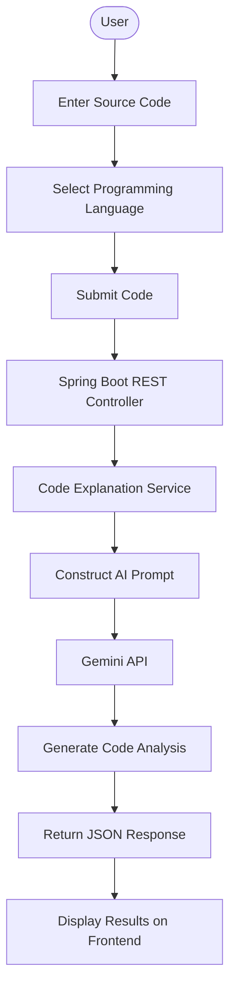

#  CodeBloom – AI Code Explainer

**Understand code and learn concepts.**

CodeBloom is an AI-powered code explanation application built using Java and Spring Boot. It helps developers understand source code by generating easy-to-follow explanations, analyzing code complexity, and providing optimization suggestions using the Gemini API.

##  Features

- **AI Code Explanation:** Generate clear explanations of submitted source code.
- **Multi-Language Support:** Analyze code written in different programming languages.
- **Complexity Analysis:** Get insights into the time and space complexity of code.
- **Code Optimization:** Receive suggestions to improve code readability and efficiency.
- **Interactive Interface:** Submit code and view AI-generated analysis through a simple interface.

## Tech Stack

| Technology | Purpose |
|---|---|
| Java 21 | Backend development |
| Spring Boot | REST API development |
| Gemini API | AI-powered code analysis |
| HTML5 | Frontend structure |
| CSS3 | Styling and layout |
| JavaScript | Frontend interactions |
| Postman | API testing |

##  Application Workflow



##  How It Works

1. **Code Input:** The user enters or pastes source code into the CodeBloom interface.
2. **Language Selection:** The user selects the programming language of the submitted code.
3. **API Request:** The frontend sends the code and selected language to the Spring Boot backend.
4. **Request Processing:** The REST controller receives the request and forwards it to the code explanation service.
5. **AI Integration:** The service constructs a prompt and sends it to the Gemini API.
6. **Code Analysis:** Gemini processes the submitted code and generates an explanation, complexity analysis, and optimization suggestions.
7. **Response Handling:** The backend receives the generated analysis and returns it to the frontend.
8. **Result Display:** CodeBloom presents the generated explanation and analysis to the user.

##  Getting Started

### Prerequisites

Make sure you have the following installed:

- Java 21 or later
- Maven
- Git
- Gemini API Key

### 1. Clone the Repository

```bash
git clone https://github.com/Ananya-vastare/CodeBloom.git
```

### 2. Navigate to the Project Directory

```bash
cd CodeBloom
```

### 3. Configure the Gemini API Key

Set your Gemini API key as an environment variable.

**Windows PowerShell:**

```powershell
$env:GEMINI_API_KEY="your_api_key"
```

### 4. Run the Application

```bash
mvn spring-boot:run
```

The Spring Boot backend will start at:

```text
http://localhost:8080
```

Open the frontend in your browser using your configured local frontend setup.

## Project Structure

```text
CodeBloom/
│
├── src/
│   └── main/
│       ├── java/
│       │   └── com/example/codebloom/
│       │       ├── Controller/
│       │       ├── Service/
│       │       └── Model/
│       │
│       └── resources/
│           └── application.properties
│
├── frontend/
│   ├── index.html
│   ├── style.css
│   └── script.js
│
├── pom.xml
└── README.md
```

## Author

**Ananya Ravikiran Vastare**

- GitHub: [Ananya-vastare](https://github.com/Ananya-vastare)
- LinkedIn: [Ananya Ravikiran Vastare](https://linkedin.com/in/ananya-ravikiran-vastare/)

---

**CodeBloom 🌸 — Making code easier to understand, one explanation at a time.**

Note: Measured API latency in Postman across 7 requests: 77 ms median, with the 6.64 s average driven by Gemini API response time
